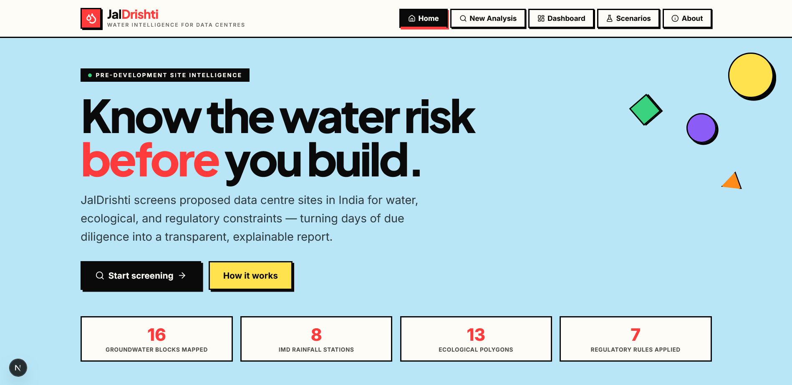

# JalDrishti

> **Water intelligence and risk-assessment decision-support system for sustainable data centres in India.**
>
> JalDrishti is a pre-development site-intelligence and feasibility screening tool. Given a proposed data-centre project and a site, it answers:
>
> *“Before investing heavily in this site, what water, ecological, regulatory, infrastructure and power-related constraints are already visible?”*

It is **not** a black-box score. It is **not** an AI that predicts whether a site is good. It is a deterministic rule engine that combines project inputs, water-demand calculations, groundwater information, surface-water information, rainfall/climate data, water-quality data, ecological GIS layers, regulatory rules, environmental-clearance applicability, CGWA groundwater/NOC logic, and evidence/provenance for every result and produces a transparent, explainable **four-way classification**.

---

## Screenshots



---

## Table of Contents

1. [What JalDrishti does](#what-jaldrishti-does)
2. [Key principles](#key-principles)
3. [Tech stack](#tech-stack)
4. [Project structure](#project-structure)
5. [Prerequisites](#prerequisites)
6. [Getting started (quick start)](#getting-started-quick-start)
7. [Available scripts](#available-scripts)
8. [Configuration](#configuration)
9. [Troubleshooting](#troubleshooting)
10. [The screening pipeline](#the-screening-pipeline)
11. [Datasets used](#datasets-used)
12. [Regulatory rules](#regulatory-rules)
13. [API reference](#api-reference)
14. [The four-way classification](#the-four-way-classification)
15. [How the AI layer fits in](#how-the-ai-layer-fits-in)
16. [Limitations \& honest gaps](#limitations--honest-gaps)
17. [Roadmap (full system)](#roadmap-full-system)
18. [Disclaimer](#disclaimer)

---

## What JalDrishti does

For a proposed data-centre site, JalDrishti:

1. **Ingests project inputs** — site coordinates, IT load, PUE, WUE, cooling technology, built-up area, land tenure, proposed water source, alternative water source.
2. **Runs spatial checks** — tests the site point against ESZ, forest, wetland and CRZ polygon layers for overlaps and proximity (Turf.js mirrors PostGIS `ST_Intersects` / `ST_Within` / `ST_Distance`).
3. **Computes water demand** — deterministic engine turns IT load × PUE × 24 × WUE into daily and annual water requirements.
4. **Looks up groundwater** — finds the nearest CGWB block and reads its category (Safe / Semi-Critical / Critical / Over-Exploited / Saline), stage of development, TDS, pre/post-monsoon depth.
5. **Looks up rainfall** — finds the nearest IMD rainfall station and reads its annual normal, monsoon normal, and 10-year time series.
6. **Applies regulatory rules** — CGWA NOC eligibility, Environmental Clearance applicability (EIA 2006 Schedule 8b), ecological constraints (ESZ / Forest / Wetland / CRZ), SPCB consent requirements.
7. **Produces a four-way classification** — Feasible / Feasible with Conditions / Data Insufficient / High Constraint.
8. **Attaches provenance** — every data point carries its source, source date, and evidence status (VERIFIED / PROXY / UNKNOWN) all the way to the final decision.
9. **Optionally generates a plain-language explanation** — an LLM summarises the structured result; it never decides feasibility and never invents values.

---

## Key principles

These are non-negotiable design rules:

1. **No black-box score.** The output is a four-way classification, not a number out of 100.
2. **AI does not decide feasibility.** The LLM only explains the structured JSON produced by the rule engine.
3. **No fabricated data.** Missing values are flagged `UNKNOWN` — never silently filled in; representative or proxy values are labeled as such.
4. **Static datasets are not called "live APIs."** The current reference GIS, rainfall, and groundwater datasets are versioned in `src/lib/data/` (with database models available for future refreshes); they are not live feeds.
5. **No invented regulatory thresholds.** Every threshold (e.g. 150,000 m² for EC 8b) comes from the cited regulation.
6. **No invented GIS buffer distances.** If a regulation specifies a buffer, it is encoded in the rule; otherwise the system reports "regulatory buffer not configured."
7. **Provenance stays attached.** Source and evidence status travel with every value into the rule engine and into the final classification.
8. **Calculations are deterministic.** Given the same inputs, the engine always produces the same output.
9. **Regulatory rules are separate from app code.** They live in `src/lib/rules/regulatory-rules.ts` and can be audited without reading the application.
10. **Every classification is explainable.** You can trace: classification → rule → constraint → underlying data → source → date → GIS geometry.

---

## Tech stack

|       Layer        |                               Technology                                |                                     Notes                                      |
| ------------------ | ----------------------------------------------------------------------- | ------------------------------------------------------------------------------ |
| Framework          | **Next.js 16** (App Router) + **TypeScript 5**                          | Non-negotiable                                                                 |
| Runtime            | **Node.js ≥ 20.9** (22/24 LTS recommended); Bun is optional             | npm is the most portable default; Bun can be used instead                      |
| Styling            | **Tailwind CSS 4** + custom neo-brutalist design system                 | Solid borders, hard shadows, no rounded corners                                |
| UI components      | **shadcn/ui** (New York style) + **Lucide** icons                       | Pre-installed component set                                                    |
| Animations         | **Framer Motion**                                                       | Page transitions, scroll reveals, counters, hover effects                      |
| State              | **Zustand** (client) + **TanStack Query** (server, available)           | View router is Zustand-based                                                   |
| Database           | **Prisma ORM** + **SQLite**                                             | No Docker required — SQLite is a single file                                   |
| Spatial operations | **Turf.js**                                                             | Mirrors PostGIS `ST_Intersects` / `ST_Within` / `ST_Distance` in the app layer |
| Maps               | **MapLibre GL** + OpenStreetMap raster tiles                            | No API key required                                                            |
| Charts             | **Recharts**                                                            | Rainfall time series, scenario comparison bars                                 |
| AI explanation     | **z-ai-web-dev-sdk**                                                    | LLM receives structured JSON, returns plain-language summary                   |
| Fonts              | **Inter** (body) + **Plus Jakarta Sans** (display) + **JetBrains Mono** | Loaded via `next/font/google`                                                  |

---

## Project structure

```
.
├── prisma/
│   └── schema.prisma              # Project, Analysis, Scenario, GroundwaterBlock,
│                                  # RainfallStation, EcologicalZone, RegulatoryRule
├── db/
│   └── custom.db                  # Local SQLite database (created/updated by db:push)
├── public/
│   ├── maplibre-gl-worker.mjs     # MapLibre worker (served from /public)
│   ├── logo.svg
│   └── robots.txt
├── src/
│   ├── app/
│   │   ├── layout.tsx             # Root layout, fonts, Toaster
│   │   ├── page.tsx               # View router (Home / Analyze / Dashboard / Scenarios / About)
│   │   ├── globals.css            # Neo-brutalist design system + animations
│   │   └── api/
│   │       ├── projects/
│   │       │   ├── route.ts                  # POST/GET /api/projects
│   │       │   └── [id]/
│   │       │       ├── route.ts              # GET /api/projects/[id]
│   │       │       ├── analyze/route.ts      # POST/GET /api/projects/[id]/analyze
│   │       │       └── scenarios/route.ts    # POST/GET /api/projects/[id]/scenarios
│   │       ├── gis/
│   │       │   ├── route.ts                  # GET /api/gis?layer=esz|forest|wetland|crz
│   │       │   └── [layer]/route.ts          # GET /api/gis/[layer]
│   │       └── explain/route.ts              # POST /api/explain (AI explanation)
│   ├── components/
│   │   ├── ui/                    # shadcn/ui components (button, card, toast, etc.)
│   │   └── jaldrishti/
│   │       ├── Header.tsx         # Sticky nav with locked-state indicators
│   │       ├── Footer.tsx         # Clean, user-friendly footer
│   │       ├── SiteMap.tsx        # MapLibre map with toggleable ecological layers
│   │       ├── ClassificationCard.tsx
│   │       ├── WaterDemandPanel.tsx
│   │       ├── GroundwaterPanel.tsx
│   │       ├── RainfallPanel.tsx
│   │       ├── RegulatoryPanel.tsx
│   │       ├── EcologyPanel.tsx
│   │       ├── PowerPanel.tsx
│   │       ├── EvidencePanel.tsx
│   │       ├── AIExplanationPanel.tsx
│   │       ├── WhatIfPanel.tsx
│   │       └── views/
│   │           ├── HomeView.tsx       # Landing page (hero, features, outcomes, CTA)
│   │           ├── AnalyzeView.tsx    # Project input form
│   │           ├── DashboardView.tsx  # Classification + map + evidence panels
│   │           ├── ScenariosView.tsx  # What-if builder + comparison chart
│   │           └── AboutView.tsx      # Methodology, datasets, rules
│   ├── lib/
│   │   ├── db.ts                          # Prisma client singleton
│   │   ├── utils.ts                       # cn() helper
│   │   ├── engines/
│   │   │   ├── water-demand.ts            # IT × PUE × 24 × WUE → daily/annual water
│   │   │   ├── classification.ts          # Four-way classification logic
│   │   │   └── orchestrator.ts            # Master pipeline: inputs → structured JSON
│   │   ├── rules/
│   │   │   └── regulatory-rules.ts        # CGWA, EC, ESZ, Forest, Wetland, CRZ, SPCB rules
│   │   ├── gis/
│   │   │   └── spatial.ts                 # Turf.js wrapper (ST_Intersects, ST_Within, ST_Distance)
│   │   ├── data/
│   │   │   ├── groundwater.ts             # 16 CGWB groundwater blocks (MH/TG/TN)
│   │   │   ├── rainfall.ts               # 8 IMD rainfall stations with 10-year series
│   │   │   └── ecological-zones.ts        # 14 ESZ/Forest/Wetland/CRZ polygons (Maharashtra)
│   │   └── stores/
│   │       └── jaldrishti-store.ts        # Zustand store (form, analysis, scenarios, view router)
│   └── hooks/
│       ├── use-toast.ts          # Toast hook (shadcn)
│       └── use-mobile.ts         # Mobile detection hook
├── .env                           # Local-only: DATABASE_URL=file:../db/custom.db
├── package.json
├── next.config.ts                 # output: "standalone"
├── tailwind.config.ts
├── tsconfig.json
└── Caddyfile                      # Optional gateway config (sandbox preview)
```

---

## Prerequisites

The setup is cross-platform and does not depend on a particular home directory or operating-system path. Choose **one** package manager: npm is the default and most portable option; Bun is optional.

|    Tool     |               Requirement                |                         Why                         |
| ----------- | ---------------------------------------- | --------------------------------------------------- |
| **Node.js** | **20.9+**; Node 22 or 24 LTS recommended | Required by Next.js 16                              |
| **npm**     | 10+ (normally bundled with Node.js)      | Default package manager and cross-platform commands |
| **Bun**     | Optional, 1.3+                           | Faster alternative to npm                           |
| **Git**     | Optional                                 | Only needed when cloning the repository             |

No Docker, PostgreSQL, or external database service is required. The core screening application uses a local SQLite file and MapLibre uses OpenStreetMap tiles. Provider credentials are needed only for the optional AI explanation endpoint.

Check your runtime before continuing:

```text
node --version
npm --version
```

---

## Getting started (quick start)

### Option A — npm (recommended)

Run all commands from the repository root—the directory containing `package.json`, `prisma/`, and `src/`.

```bash
# Clone the repository (skip this line if you already have the project)
# Replace <repository-url> with the actual remote URL.
git clone <repository-url> jaldrishti
cd jaldrishti

# Install dependecies
npm install
```

Initialize the database and start the app:

```bash
# Creates/updates the SQLite schema and regenerates Prisma Client
npm run db:push

# Starts Next.js
npm run dev
```

Open [http://localhost:3000](http://localhost:3000).

As an API smoke test, open [http://localhost:3000/api/projects](http://localhost:3000/api/projects). A healthy server returns HTTP `200` with a JSON response containing a `projects` array. The `db:push` output should also identify the database as `file:../db/custom.db`; a different but writable SQLite path can otherwise return an empty array from the wrong database.

### Option B — Bun

Run the clone and `cd` steps first, then create the same `.env` file before running Prisma:

```bash
# Clone the repository (skip this line if you already have the project)
git clone <repository-url> jaldrishti
cd jaldrishti
```

```env
DATABASE_URL=file:../db/custom.db
```

Then install and run:

```bash
bun install
bun run db:push
bun run dev
```

If `db/` is missing, use the matching directory command from Option A first. Do not switch between npm and Bun during the same installation unless you intend to regenerate a lockfile.

### Accessing the app from another computer or phone

Connect both devices to the same trusted network, then bind the development server to the local network:

```bash
npm run dev -- --hostname 0.0.0.0
```

Use the `Network` URL printed by Next.js, such as `http://192.168.1.50:3000`. Do not expose a development server directly to the public internet.

---

## Available scripts

|          npm          |          Bun          |                                 What it does                                 |
| --------------------- | --------------------- | ---------------------------------------------------------------------------- |
| `npm run dev`         | `bun run dev`         | Start the development server on port 3000                                    |
| `npm run build`       | `bun run build`       | Create a production build                                                    |
| `npm run lint`        | `bun run lint`        | Run ESLint                                                                   |
| `npm run db:push`     | `bun run db:push`     | **Initial local setup:** create/update the SQLite schema and generate Prisma Client |
| `npm run db:generate` | `bun run db:generate` | Regenerate Prisma Client, especially after schema or dependency changes      |
| `npm run db:migrate`  | `bun run db:migrate`  | Alternate interactive migration workflow; no migrations are checked in yet |
| `npm run db:reset`    | `bun run db:reset`    | Destructive migration reset; current repository has no checked-in migrations |

> `db:push` uses `--accept-data-loss` to make local schema synchronization predictable. It normally retains compatible rows, but schema changes can drop or recreate data. Back up `db/custom.db` before running it against a database whose data matters.

The current repository uses `db:push` for its initial schema. There is no checked-in `prisma/migrations/` history, so do not mix `db:migrate` and `db:push` casually. `db:reset` cannot reconstruct the current schema from migration history in this repository; if it is used, take a backup and follow it with `db:push` to recreate the schema.

The quick start is for local development. There is currently no `start` script in `package.json`; `next.config.ts` enables standalone output for a separate production deployment workflow.

---

## Configuration

### Environment variable (`.env`)

Create `.env` in the repository root with this exact value:

```env
DATABASE_URL=file:../db/custom.db
```

Prisma resolves SQLite paths relative to `prisma/schema.prisma`:

```text
<repository>/prisma/schema.prisma
                          + ../db/custom.db
<repository>/db/custom.db
```

This relative URL is portable across Windows, macOS, and Linux. It does not require a home-directory-specific absolute path.

Do **not** use:

```env
# Wrong: resolves to <repository>/prisma/db/custom.db
DATABASE_URL=file:db/custom.db

# Device-specific examples that should not be copied between machines
DATABASE_URL=file:/home/username/jaldrishti/db/custom.db
DATABASE_URL=file:C:/Users/username/Projects/jaldrishti/db/custom.db
```

Because `.env` is intentionally ignored by Git, every new clone or device needs its own `.env` file. The value is identical everywhere.

### SQLite database and backups

- The database is `<repository>/db/custom.db`.
- `npm run db:push` normally retains compatible rows while synchronizing the Prisma schema, but schema changes can drop or recreate data; back up the database first.
- In the current MVP, the reference groundwater, rainfall, and GIS datasets used by the UI/engines are bundled under `src/lib/data/`; `db:push` creates the schema but is not a dataset seed command.
- Stop the dev server before copying or backing up the database.
- To move existing projects to another device, copy `db/custom.db` while the server is stopped; copying `.env` alone does not copy the data.
- Never delete `db/custom.db` unless a fresh empty database is intended.
- If an older setup created `prisma/db/custom.db`, correct `.env` to `file:../db/custom.db`; that other file will no longer be used. Back it up before removing anything.

### MapLibre worker

The worker at `public/maplibre-gl-worker.mjs` is a copy of the installed MapLibre worker. If `maplibre-gl` is upgraded, refresh it with the command for your shell:

```powershell
# Windows PowerShell
Copy-Item node_modules/maplibre-gl/dist/maplibre-gl-worker.mjs public/maplibre-gl-worker.mjs
```

```text
# Windows Command Prompt
copy /Y node_modules\maplibre-gl\dist\maplibre-gl-worker.mjs public\maplibre-gl-worker.mjs
```

```bash
# macOS or Linux
cp node_modules/maplibre-gl/dist/maplibre-gl-worker.mjs public/maplibre-gl-worker.mjs
```

### AI explanation layer

The deterministic screening pipeline does not require an LLM. `/api/explain` additionally uses `z-ai-web-dev-sdk`; that provider must be configured with valid local credentials outside an environment that pre-configures the SDK.

For local AI explanations, create `.z-ai-config` in the repository root (or use one of the other locations supported by the SDK):

```json
{
  "baseUrl": "https://your-provider.example/v1",
  "apiKey": "your-api-key"
}
```

`baseUrl` should include the provider's `/v1` path. `chatId` and `userId` are optional. The file is ignored by Git; never commit real API keys. If the AI endpoint fails, the project, analysis, and classification APIs remain usable.

---

## Troubleshooting

Run these commands from the repository root unless a section says otherwise.

### `@prisma/client did not initialize yet`

Typical message:

```text
@prisma/client did not initialize yet. Please run "prisma generate" and try to import it again.
```

Stop the dev server with `Ctrl+C`, then run the smallest repair first:

```bash
npm install
npm run db:generate
npm run dev
```

With Bun, use:

```bash
bun install
bun run db:generate
bun run dev
```

This usually happens when dependencies were installed with lifecycle scripts disabled, `node_modules` was copied from another operating system, or `prisma/schema.prisma` changed. If `node_modules` may have been copied from another device, do a full reinstall rather than deleting only `.prisma`:

```powershell
# Windows PowerShell
Remove-Item -Recurse -Force node_modules -ErrorAction SilentlyContinue
Remove-Item -Recurse -Force .next -ErrorAction SilentlyContinue
npm ci
npm run db:generate
npm run db:push
npm run dev
```

```text
# Windows Command Prompt
if exist node_modules rmdir /S /Q node_modules
if exist .next rmdir /S /Q .next
npm ci
npm run db:generate
npm run db:push
npm run dev
```

```bash
# macOS or Linux
rm -rf node_modules .next
npm ci
npm run db:generate
npm run db:push
npm run dev
```

For Bun, do the same full cleanup when `node_modules` was copied:

```powershell
# Windows PowerShell
Remove-Item -Recurse -Force node_modules -ErrorAction SilentlyContinue
Remove-Item -Recurse -Force .next -ErrorAction SilentlyContinue
bun install
bun run db:generate
bun run db:push
bun run dev
```

```text
# Windows Command Prompt
if exist node_modules rmdir /S /Q node_modules
if exist .next rmdir /S /Q .next
bun install
bun run db:generate
bun run db:push
bun run dev
```

```bash
# macOS or Linux
rm -rf node_modules .next
bun install
bun run db:generate
bun run db:push
bun run dev
```

### SQLite `Error code 14: Unable to open the database file`

Typical API error:

```text
Error querying the database: Error code 14: Unable to open the database file
```

This usually means the SQLite URL points to a missing directory, uses a path copied from another device, or the target directory is not writable. Check that `.env` contains exactly:

```env
DATABASE_URL=file:../db/custom.db
```

A process-level environment variable can override `.env`. Check the effective value before retrying:

```powershell
# Windows PowerShell
$env:DATABASE_URL
```

```text
# Windows Command Prompt
echo %DATABASE_URL%
```

```bash
# macOS or Linux
printf '%s\n' "${DATABASE_URL:-<not set>}"
```

If it is set to a path from another device, clear it and let Prisma load `.env`:

```powershell
# Windows PowerShell
$env:DATABASE_URL = $null
```

```text
# Windows Command Prompt
set DATABASE_URL=
```

```bash
# macOS or Linux
unset DATABASE_URL
```

If `db/` is missing, create it with the idempotent command for your shell:

```powershell
# Windows PowerShell
New-Item -ItemType Directory -Force db | Out-Null
```

```text
# Windows Command Prompt
if not exist db mkdir db
```

```bash
# macOS or Linux
mkdir -p db
```

Back up `db/custom.db` before synchronizing a schema, then run:

```bash
npm run db:push
npm run dev
```

Important details:

- `file:../db/custom.db` is the portable project-root value.
- `file:db/custom.db` points under `prisma/` and causes the same problem when `prisma/db/` does not exist.
- Never copy a `C:\Users\...` or `/home/...` database URL to another device.
- Keep the project in a normal user-writable directory rather than a read-only system folder.
- Code 14 is generally an open/create/path-permission problem. Lock contention is covered separately under “Database is locked.”

### `P2021`, “table does not exist,” or schema errors

The database exists but does not match `prisma/schema.prisma`. Back up the database, then synchronize it:

```bash
npm run db:push
npm run dev
```

If a schema was recently edited, also regenerate the client explicitly:

```bash
npm run db:generate
```

### `Environment variable not found: DATABASE_URL`

Create `.env` in the directory containing `package.json`, using the exact portable value:

```env
DATABASE_URL=file:../db/custom.db
```

Stop and restart the dev server after changing `.env`. Running Prisma commands from a parent/home directory can also load the wrong or no environment file.

### Database is locked

Close duplicate `next dev` processes and any other tool currently writing to `db/custom.db`, then restart one server. Do not delete the database merely to clear a lock.

### Port 3000 is already in use

Start the same project on another port:

```bash
npm run dev -- --port 3001
```

Then open [http://localhost:3001](http://localhost:3001). With Bun:

```bash
bun run dev -- --port 3001
```

### Changes are not appearing

Stop the dev server and remove the generated `.next` cache:

```powershell
# Windows PowerShell
Remove-Item -Recurse -Force .next -ErrorAction SilentlyContinue
npm run dev
```

```text
# Windows Command Prompt
if exist .next rmdir /S /Q .next
npm run dev
```

```bash
# macOS or Linux
rm -rf .next
npm run dev
```

If Prisma also reports a client-generation problem, run `npm run db:generate` before restarting.

### Next.js warns that a parent `package-lock.json` was ignored

Example:

```text
Next.js ignored package-lock.json ... because it would include your home directory.
```

This warning is usually non-blocking. First make sure the command is running in the JalDrishti repository root, not the user home directory. The application can be run without changing anything in the home directory.

To pin Turbopack to this project without touching a parent lockfile, add an absolute, cross-platform root to `next.config.ts`:

```ts
import path from "node:path";
import { fileURLToPath } from "node:url";
import type { NextConfig } from "next";

const projectRoot = path.dirname(fileURLToPath(import.meta.url));

const nextConfig: NextConfig = {
  turbopack: { root: projectRoot },
  output: "standalone",
  typescript: {
    ignoreBuildErrors: true,
  },
  reactStrictMode: false,
};

export default nextConfig;
```

Do not delete a parent lockfile unless you own it and know it is unused.

### Only the AI explanation fails

A `500` from `/api/explain` usually means the local `z-ai-web-dev-sdk` provider is not configured. Create `.z-ai-config` as shown in the [AI explanation layer](#ai-explanation-layer) section. This does not affect deterministic screening or database-backed endpoints. Configure the provider for that environment or omit the optional explanation request.

---

## The screening pipeline

```
USER INPUT
    ↓
LOCATION / COORDINATES  →  normalized site point
    ↓
DATA INPUTS  →  versioned static reference fixtures in `src/lib/data/` (MVP)
    ↓
SPATIAL PROCESSING  →  Turf.js checks against the bundled GIS fixtures
    ↓
WATER DEMAND ENGINE  →  IT × PUE × 24 × WUE → daily / annual water
    ↓
REGULATORY / SITE CONSTRAINT ENGINE
    ├─ CGWA groundwater NOC rule
    ├─ EC applicability rule (EIA 2006 8b)
    ├─ Ecological constraint rules (ESZ / Forest / Wetland / CRZ)
    └─ SPCB consent rule
    ↓
WHAT-IF SCENARIO ENGINE  →  deterministic recalculation
    ↓
EVIDENCE + PROVENANCE ENGINE  →  source / date / evidence status attached
    ↓
FEASIBILITY CLASSIFICATION  →  Feasible | Feasible with Conditions | Data Insufficient | High Constraint
    ↓
STRUCTURED JSON
    ↓
OPTIONAL AI EXPLANATION  →  plain-language summary (never decides)
    ↓
DASHBOARD / REPORT
```

**AI, if used, comes only AFTER the deterministic calculations.** It can explain the result in simple language. It must NOT independently decide whether the site is feasible.

---

## Datasets used

The current MVP uses curated, versioned reference fixtures based on cited Indian public sources. They are not live feeds and are not automatically refreshed. Values marked `PROXY` or `UNKNOWN` are intentionally surfaced as such; representative or approximate fixture values must not be treated as a current official record.

### Groundwater (16 blocks)

**Source:** Central Ground Water Board (CGWB) *Ground Water Year Book* — Maharashtra, Telangana, Tamil Nadu states.

Each block carries:

- State, district, block name
- Stage of groundwater development (%)
- Category: `Safe` | `Semi-Critical` | `Critical` | `Over-Exploited` | `Saline`
- Pre-monsoon and post-monsoon depth to water table (mbgl)
- Annual recharge and extraction (ham)
- TDS (mg/L)
- Source, source date, evidence status

**Covered blocks include:** Panvel, Taloja, Uran, Karjat, Khalapur, Pen (Raigad); Andheri-Borivali (Mumbai Suburban); Haveli, Maval, Khed, Mulshi (Pune); Nashik-City; Nagpur-Urban; Bhiwandi (Thane); Hyderabad-Urban; Chennai-City.

**File:** `src/lib/data/groundwater.ts`

### Rainfall (8 stations)

**Source:** India Meteorological Department (IMD) *District-Wise Rainfall Statistics*.

Each station carries:

- Station name, state, district, latitude, longitude
- Annual normal (mm)
- Monsoon normal (Jun–Sep, mm)
- Post-monsoon, winter, summer rainfall (mm)
- 10-year annual time series
- Source, source date, evidence status

**Covered stations:** Mumbai (Santacruz), Mumbai (Colaba), Taloja (MIDC), Pune, Nashik, Nagpur, Hyderabad, Chennai.

**File:** `src/lib/data/rainfall.ts`

### Ecological GIS layers (14 polygons)

**Sources:** MoEFCC ESZ Notifications, Forest (Conservation) Act 1980, Wetlands (Conservation and Management) Rules 2017, CRZ Notification 2018, Maharashtra State Wetland Authority, Maharashtra Forest Department.

Each polygon carries:

- Layer type: `esz` | `forest` | `wetland` | `crz`
- Name, category, state
- GeoJSON Polygon geometry (EPSG:4326 / WGS84)
- Source, source date, evidence status

**Covered polygons (Maharashtra region):** Sanjay Gandhi NP ESZ, Tungareshwar WLS ESZ, Karnala Bird Sanctuary ESZ, Matheran ESZ, Tungareshwar RF, Bhimgad RF, Matheran Forest Block, Thane Creek Flamingo Sanctuary, Mahim Creek Mangroves, Vasai Creek Mangroves, Panvel Creek Mangroves, Mumbai West Coast CRZ, Navi Mumbai East Coast CRZ, Uran Coast CRZ.

**File:** `src/lib/data/ecological-zones.ts`

### Power

Power connection timeline is **UNKNOWN** in the MVP. No live DISCOM / CEA API is integrated. The system explicitly reports `UNKNOWN` rather than fabricating a timeline.

---

## Regulatory rules

Rules are encoded as auditable TypeScript modules in `src/lib/rules/regulatory-rules.ts`. Each rule references the actual Indian regulation it implements.

|     Rule code     | Domain  |                             Title                             |                            Source                             |
| ----------------- | ------- | ------------------------------------------------------------- | ------------------------------------------------------------- |
| `CGWA-2020`       | cgwa    | CGWA Groundwater NOC Eligibility                              | CGWA NOC Guidelines for Groundwater Extraction (revised 2020) |
| `EC-8B-2006`      | ec      | Environmental Clearance — Item 8(b) Township/Area Development | EIA Notification 2006, Schedule Item 8(b)                     |
| `ESZ-EPA-1986`    | esz     | Eco-Sensitive Zone Restrictions                               | ESZ Notification under Environment (Protection) Act 1986      |
| `FOREST-CA-1980`  | forest  | Forest (Conservation) Act 1980                                | Forest (Conservation) Act 1980 (amended 2023)                 |
| `WETLAND-2017`    | wetland | Wetlands (Conservation and Management) Rules 2017             | Wetlands Rules 2017                                           |
| `CRZ-2018`        | crz     | Coastal Regulation Zone Notification 2018                     | CRZ Notification 2018                                         |
| `SPCB-WATER-1974` | spcb    | Water Act — CTE / CTO requirement                             | Water (Prevention and Control of Pollution) Act 1974          |

### Key thresholds

- **EC applicability:** Built-up area ≥ **150,000 m²** triggers Category B EC under EIA 2006 Schedule 8(b).
- **CGWA Over-Exploited + groundwater source + no alternative:** Hard constraint.
- **CGWA Critical + groundwater source:** Feasible with conditions (rainwater harvesting + artificial recharge required).
- **Ecological overlap (ESZ / Forest / Wetland / CRZ):** Hard constraint — project must re-site or pursue clearance.

Where a buffer distance is not specified in the source regulation, the system reports *"regulatory buffer not configured"* rather than inventing one.

---

## API reference

All endpoints are relative to the app root (e.g. `http://localhost:3000`).

### Projects

| Method |         Path         |                                                                                                Description                                                                                                |
| ------ | -------------------- | --------------------------------------------------------------------------------------------------------------------------------------------------------------------------------------------------------- |
| `POST` | `/api/projects`      | Create a new project. Body: `{ projectName, latitude, longitude, itLoad, pue, wue, coolingType, builtUpArea?, landTenure, proposedWaterSource, alternativeWaterSource?, notes? }`. Returns `{ project }`. |
| `GET`  | `/api/projects`      | List the 100 most recent projects. Returns `{ projects }`.                                                                                                                                                |
| `GET`  | `/api/projects/[id]` | Get a single project. Returns `{ project }`.                                                                                                                                                              |

### Analysis

| Method |             Path             |                                                                  Description                                                                   |
| ------ | ---------------------------- | ---------------------------------------------------------------------------------------------------------------------------------------------- |
| `POST` | `/api/projects/[id]/analyze` | Run the full screening pipeline. Persists the result. Returns `{ analysisId, result }` where `result` is the full structured JSON (see below). |
| `GET`  | `/api/projects/[id]/analyze` | Get the most recent analysis for a project. Returns `{ analysisId, result, generatedAt, hasAnalysis }`.                                        |

### What-if scenarios

| Method |              Path              |                                                              Description                                                              |
| ------ | ------------------------------ | ------------------------------------------------------------------------------------------------------------------------------------- |
| `POST` | `/api/projects/[id]/scenarios` | Run a what-if scenario. Body: `{ label, itLoad?, pue?, wue?, coolingType?, proposedWaterSource? }`. Returns `{ scenarioId, result }`. |
| `GET`  | `/api/projects/[id]/scenarios` | List the 50 most recent scenarios for a project. Returns `{ scenarios }`.                                                             |

### GIS layers

| Method |        Path        |                                               Description                                                |         |          |                 |
| ------ | ------------------ | -------------------------------------------------------------------------------------------------------- | ------- | -------- | --------------- |
| `GET`  | `/api/gis`         | Get all ecological layers as a single GeoJSON FeatureCollection. Optional `?layer=esz\                   | forest\ | wetland\ | crz` to filter. |
| `GET`  | `/api/gis/[layer]` | Get a single layer as a GeoJSON FeatureCollection. `layer` must be `esz`, `forest`, `wetland`, or `crz`. |         |          |                 |

### AI explanation

| Method |      Path      |                                                                                                                                                                    Description                                                                                                                                                                     |
| ------ | -------------- | -------------------------------------------------------------------------------------------------------------------------------------------------------------------------------------------------------------------------------------------------------------------------------------------------------------------------------------------------- |
| `POST` | `/api/explain` | Generate a plain-language explanation of an analysis. Body: `{ analysis: <AnalysisResult JSON> }`. Returns `{ explanation, prompt }`. The LLM receives the structured JSON and returns Markdown with a plain-language explanation, evidence summary, and suggested follow-up questions. **It never decides feasibility and never invents values.** |

### Analysis result JSON structure

```jsonc
{
  "projectId": "cmuf...",
  "projectName": "Taloja DC Park - Building 1",
  "site": {
    "latitude": 19.0418,
    "longitude": 73.0856,
    "pointWkt": "POINT(73.0856 19.0418)",
    "crs": "EPSG:4326 (WGS84)"
  },
  "waterDemand": {
    "facilityEnergyKwhPerDay": 3360000,
    "waterKlPerDay": 5040,
    "waterMcmPerYear": 1.84,
    "wueUsed": 1.5,
    "wueSource": "ASHRAE TC9.9 typical for water-cooled cooling tower",
    "provenance": { "source": "...", "sourceDate": "...", "evidenceStatus": "VERIFIED" }
  },
  "groundwater": {
    "block": "Taloja",
    "district": "Raigad",
    "state": "Maharashtra",
    "category": "Critical",
    "stage": 112.6,
    "tds": 1180,
    "preMonsoon": 8.9,
    "postMonsoon": 6.4,
    "distanceKm": 0.5,
    "provenance": { "source": "CGWB ...", "sourceDate": "2023-04", "evidenceStatus": "VERIFIED" }
  },
  "rainfall": {
    "station": "Taloja (MIDC)",
    "annualNormal": 2380,
    "monsoonNormal": 2120,
    "distanceKm": 0.3,
    "timeseries": [{ "year": 2014, "annual": 2098 }, /* ... */],
    "provenance": { "source": "IMD ...", "sourceDate": "2023-12", "evidenceStatus": "PROXY" }
  },
  "ecology": {
    "esz":     { "overlap": false, "nearestDistanceKm": 12.4, "intersectedPolygons": [], "rule": { /* ... */ } },
    "forest":  { "overlap": false, "nearestDistanceKm": 8.1,  "intersectedPolygons": [], "rule": { /* ... */ } },
    "wetland": { "overlap": true,  "nearestDistanceKm": 0,    "intersectedPolygons": [{ "name": "Panvel Creek Mangroves" }], "rule": { /* ... */ } },
    "crz":     { "overlap": false, "nearestDistanceKm": 5.2,  "intersectedPolygons": [], "rule": { /* ... */ } }
  },
  "regulatory": {
    "cgwa": { "outcome": "FEASIBLE WITH CONDITIONS", "reasons": [...], "hardConstraint": false, "provenance": {...} },
    "ec":   { "outcome": "NOT TRIGGERED",            "reasons": [...], "hardConstraint": false, "provenance": {...} },
    "spcb": { "outcome": "CONSENT TO ESTABLISH REQUIRED", "reasons": [...], "hardConstraint": false, "provenance": {...} }
  },
  "power": { "timeline": "UNKNOWN", "substation": null, "provenance": { "evidenceStatus": "UNKNOWN" } },
  "constraints": [ /* all constraint items with kind: hard | soft | info */ ],
  "evidenceGaps": [ /* critical missing fields that block a confident decision */ ],
  "classification": {
    "classification": "High Constraint / Further Assessment Required",
    "reasons": ["[HARD] WETLAND overlap: WETLAND OVERLAP DETECTED", /* ... */],
    "hardConstraints": [...],
    "softConstraints": [...],
    "evidenceGaps": [...],
    "trace": [
      { "step": "1. Hard constraint scan",     "result": "1 hard constraint(s) found" },
      { "step": "2. Critical evidence scan",  "result": "0 critical gap(s) found" },
      { "step": "3. Soft constraint scan",    "result": "2 soft constraint(s) found" },
      { "step": "4. Decision",                "result": "HIGH CONSTRAINT" }
    ]
  },
  "generatedAt": "2026-09-24T12:34:56.789Z"
}
```

---

## The four-way classification

The classification is a deterministic function of hard constraints, evidence gaps, and soft conditions.

### Precedence

```
1. HIGH CONSTRAINT          ← any hard constraint present
2. DATA INSUFFICIENT        ← a critical evidence field is UNKNOWN
3. FEASIBLE WITH CONDITIONS ← soft constraint present (no hard, no gaps)
4. FEASIBLE                 ← no constraints, no gaps
```

### Categories

|                     Category                      |                                         When                                         |  Color   |
| ------------------------------------------------- | ------------------------------------------------------------------------------------ | -------- |
| **Feasible**                                      | No hard constraints, no critical evidence gaps, no soft constraints                  | 🟢 Green  |
| **Feasible with Conditions**                      | Soft constraints present (e.g. CGWA Critical block requires rainwater harvesting)    | 🟡 Yellow |
| **Data Insufficient**                             | A critical evidence field is missing (e.g. groundwater block category is UNKNOWN)    | 🟠 Orange |
| **High Constraint / Further Assessment Required** | A hard constraint is present (e.g. wetland overlap, Over-Exploited + no alternative) | 🔴 Red    |

### Hard constraints vs risk indicators

- **Hard constraints** block the project outright — e.g. ecological polygon overlap, Over-Exploited groundwater + no alternative source, Saline block + groundwater source.
- **Risk indicators (soft constraints)** require mitigation but do not block — e.g. Critical/Semi-Critical groundwater, EC applicable (process requirement), SPCB consent required.

The exact rule precedence is implemented in `src/lib/engines/classification.ts` and is fully auditable.

---

## How the AI layer fits in

```
DATA
  ↓
RULE ENGINE
  ↓
STRUCTURED JSON
  ↓
AI EXPLANATION   ← the LLM only sees the structured JSON
  ↓
HUMAN-READABLE REPORT
```

The AI can:

- Explain the results in plain language
- Summarise the evidence (Verified / Proxy / Unknown)
- Suggest questions the developer should investigate next

The AI must NOT:

- Invent groundwater values
- Invent regulatory thresholds
- Invent buffer distances
- Decide feasibility independently
- Override the rule engine
- Claim that an approval is guaranteed
- Convert missing data into a positive/negative assumption

The AI receives the validated structured JSON — never raw database access.

---

## Limitations & honest gaps

JalDrishti is a **screening prototype**, not a regulatory approval. The following are known limitations:

|        Area         |                     Current state                     |                        Full-system goal                        |
| ------------------- | ----------------------------------------------------- | -------------------------------------------------------------- |
| Groundwater         | 16 CGWB blocks (MH/TG/TN), nearest-centroid lookup    | All-India block polygons, live CGWB telemetry                  |
| Rainfall            | 8 IMD stations, nearest-station lookup                | IMD gridded API, seasonal variability                          |
| Ecological layers   | 14 polygons (Maharashtra region)                      | Full national MoEFCC / Bhuvan layers                           |
| Power               | UNKNOWN (no live DISCOM API)                          | State DISCOM / CEA API integration                             |
| Surface water       | Not integrated (no India-WRIS live feed)              | India-WRIS / CWC live integration                              |
| SPCB                | Generic CTE/CTO requirement (no state-specific rules) | Multi-state SPCB rule sets                                     |
| Climate projections | Not included                                          | Seasonal rainfall variability, flood-zone, climate projections |
| Block lookup        | Nearest centroid (PROXY if >5km from seeded centroid) | True `ST_Within` against block boundary polygons               |

Where data is unavailable, JalDrishti says **UNKNOWN** — it never silently fills in a value.

---

## Roadmap (full system)

The MVP is a working vertical slice. The full system would add:

- Live India-WRIS surface-water integration
- Live CGWB groundwater-level telemetry
- Full national ecological layers (all states)
- Power connection timeline modelling (DISCOM / CEA APIs)
- Climate projections (seasonal rainfall, flood-zone)
- Multi-state SPCB rules
- Direct PARIVESH project-status integration
- Competing local water demand modelling
- More detailed flood/hydrological modelling
- PostGIS / PostgreSQL backend (for production-grade spatial queries at scale)

---

## Disclaimer

JalDrishti is a **pre-development screening aid**, not a regulatory approval. All classifications should be reviewed by qualified environmental and legal consultants before any investment decision.

Missing data is flagged as **Unknown** — it is never silently filled in. The four-way classification is a screening signal, not a guarantee of regulatory outcome.

---

**Built for sustainable data-centre development in India.**
