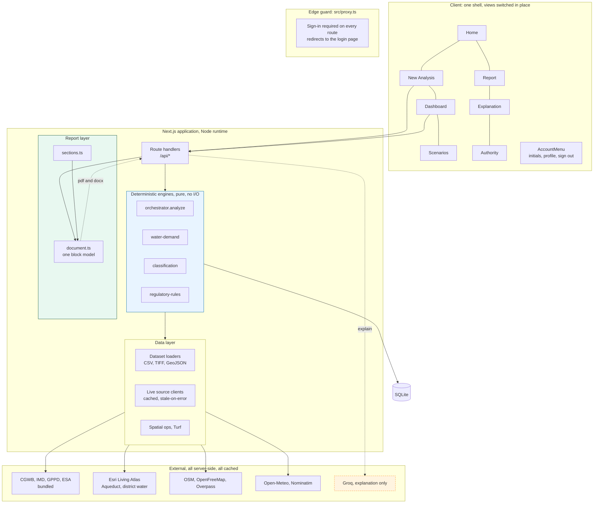
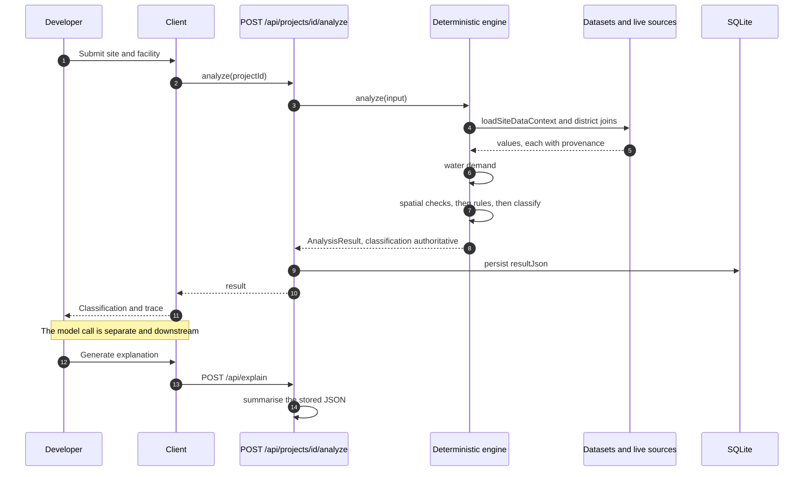
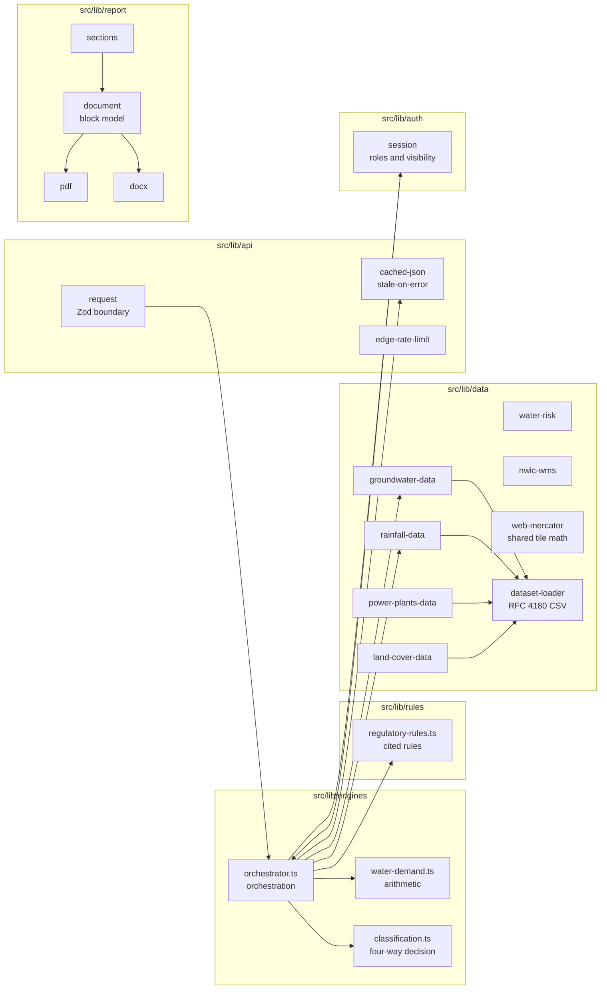
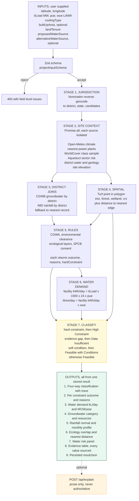
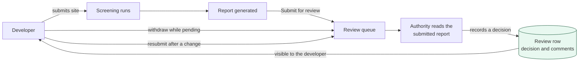
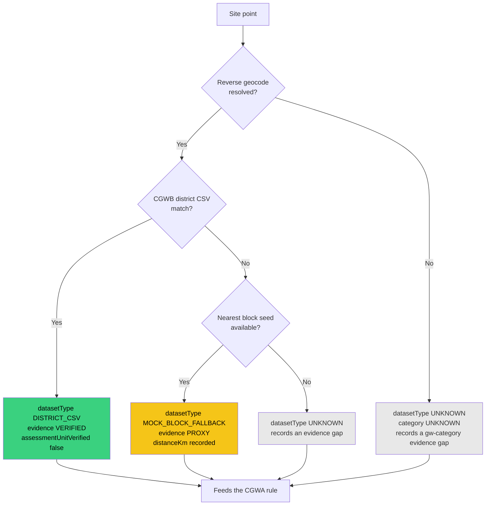
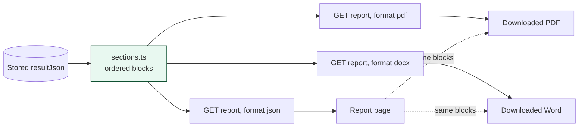

# JalDrishti Technical Approach

How the screening works, why it is built this way, and what it deliberately does not do.

## Contents

1. [Use case](#1-use-case)
2. [Goals and limits](#2-goals-and-limits)
3. [Tech stack](#3-tech-stack)
4. [Data sources](#4-data-sources)
5. [Architecture](#5-architecture)
6. [Data flow](#6-data-flow)
7. [Methodology](#7-methodology)
8. [Evidence model](#8-evidence-model)
9. [Design decisions](#9-design-decisions)
10. [Reliability](#10-reliability)
11. [Reports](#11-reports)
12. [Limitations](#12-limitations)

## 1. Use case

A developer is considering a data-centre site in India. Before committing land, money and
water, they want to know whether the site is plausible, and on what evidence.

Most of the questions are answerable from public data: how much water the facility will
need, how stressed the local aquifer is, whether the plot touches a protected boundary,
and which permissions the project is likely to trigger.

JalDrishti answers those questions early, in minutes rather than months, and shows the
reasoning. It is a screening aid. It is not an approval, and it is not the authority.

**Four outcomes, not a score.** A single number hides the reason. The output is one of:

| Outcome | Meaning |
|---|---|
| Feasible | No hard constraint, no evidence gap, no soft condition |
| Feasible with Conditions | Conditions exist and must be addressed and verified |
| Data Insufficient | Required evidence was unavailable, so no conclusion follows |
| High Constraint | A hard constraint was triggered, further assessment is required |

## 2. Goals and limits

**Goals**

- Calculate water demand from submitted parameters, using a published formula.
- Test the site against ecological and regulatory boundaries.
- State every finding with its source and its date.
- Distinguish what is calculated, what is sourced, and what needs verification.
- Produce a document a reviewer can act on and export.

**Not goals**

- Not a substitute for environmental, legal or engineering consultants.
- Not a statutory approval, consent, or compliance statement.
- Not a site survey. Most values are regional or modelled.
- Not a GIS product. The map gives context and is not the deliverable.
- Not an AI decision maker. See [section 5.2](#52-the-llm-never-decides).

## 3. Tech stack

23 runtime dependencies, kept deliberately small.

| Area | Choice | Why |
|---|---|---|
| Framework | Next.js 16, App Router, React 19 | One codebase for the web app and the standalone desktop build |
| Language | TypeScript, strict | The analysis contract is shared across many modules |
| Styling | Tailwind CSS 4, CSS-first tokens | Design lives in `globals.css`, not in a stale config file |
| UI | Local primitives, Radix for the toast | The product needs a document, not a component library |
| Database | Prisma 6 on SQLite | Single file, no service to run, easy to ship in an installer |
| Geospatial | Turf, MapLibre GL | Point in polygon and a context map |
| State | Zustand | One store, shared by the app shell and the panels |
| Charts | Recharts | Rainfall time series |
| PDF | pdfkit | Pure JavaScript, no headless browser |
| Word | docx | Pure JavaScript, no headless browser |
| Passwords | bcryptjs | Pure JavaScript, no native build step |

The project was reduced from 72 dependencies to 23. See commit `51f5249`.

## 4. Data sources

### 4.1 Bundled (9.4 MB)

| Dataset | Use |
|---|---|
| `district_wise_rainfall.csv` | District rainfall normals and time series |
| `ground_water_2017.csv` | CGWB district recharge, extraction, stage |
| `india_power_plant_dataset.csv` | Nearby generation as context only |
| `rainfall_in_india_1901-2015.csv` | Long-run rainfall series |
| `India_Land_Cover/` (120 GeoTIFFs) | ESA WorldCover class at the site point |

These are bundled so the app returns a result with no network and no key. The WorldCover
rasters are sampled on every run, so they are load bearing, not decoration.

### 4.2 Live

Open-Meteo for weather and forecast, CAMS for air quality, GloFAS for river discharge,
Nominatim for reverse geocoding, WRI Aqueduct for water risk, and Overpass plus
OpenFreeMap for ecological boundaries. Nominatim requires a contact in its User-Agent,
and `write-runtime-config.mjs` refuses to bake a placeholder domain that the service
blocks.

### 4.3 Hygiene

Bundled data is used first, live data second, and both are labelled. A provider that does
not respond is recorded as a failure, never silently replaced with a plausible value.

## 5. Architecture

### 5.1 Layers



The two subgraphs that matter are `ENG` and `LLM`. Everything in `ENG` is deterministic
and every call from it goes down into `LIB` or into SQLite. The only path to the model is
the dotted one, and it leaves the result behind.

### 5.2 The LLM never decides

The boundary is enforced in the prompt, in the schema, and in the UI.

The analysis runs first and produces a classification. Only then is the structured result
sent to the model, which may restate it, summarise the evidence, and draft questions. The
model receives no authority to change the outcome, and the UI labels its output
"AI-assisted explanation".

This is a design constraint, not a setting. If the explanation contradicts the result, the
result is correct.



The second half of that sequence is the whole point. The first half finishes and persists
before the model is ever contacted.

### 5.3 Module map

| Module | Responsibility |
|---|---|
| `engines/orchestrator.ts` | Runs providers, assembles `AnalysisResult` |
| `engines/water-demand.ts` | The demand formula and WUE reference bands |
| `engines/classification.ts` | Constraints and gaps to a four-way outcome |
| `rules/regulatory-rules.ts` | The rule set, kept separate from app code |
| `data/site-data.ts` | Fan-out to every provider, in parallel |
| `report/document.ts` | The shared block model for all report formats |
| `auth/session.ts` | Sessions, roles, project visibility |



## 6. Data flow

### 6.1 End to end



In words:

1. The developer submits site coordinates, IT load, PUE, WUE, cooling and water source.
2. `POST /api/projects` validates against a Zod schema and stores the row.
3. `POST /api/projects/:id/analyze` runs `analyze()`.
4. `site-data.ts` fans out to every provider in parallel, capturing failures.
5. The water demand engine computes demand from the submitted parameters.
6. Ecological and regulatory rules evaluate the site.
7. `classify()` resolves constraints and gaps into an outcome.
8. The full result is stored as JSON on the analysis row.
9. The dashboard, the report and any export all read that one stored result.

### 6.2 Validation boundary

Every request body is parsed with Zod before it reaches a handler, and every route
re-verifies the session against the database. The edge guard in `proxy.ts` only checks for
the presence of a cookie, because the edge runtime cannot reach the database, so it is a
navigation guard and not the security boundary.

### 6.3 Output by consumer

| Consumer | Gets |
|---|---|
| Dashboard | The live result, section by section |
| Report | A printable document, plus PDF and Word |
| Scenarios | Recomputed results for changed parameters |
| Authority | The submitted document, read only, plus the review controls |

### 6.4 Developer and authority



Two rules protect the trail. A submission can be withdrawn only while it is still pending,
because once a decision exists it is part of the record. And an Authority can read any
project but cannot run a screening or change a submission.

## 7. Methodology

### 7.1 Water demand

Published formula, no estimate:

```
facility energy (kWh/day) = IT load (kW) x 24 x PUE
water demand (L/day)      = facility energy (kWh/day) x WUE (L/kWh)
annual (MCM/year)         = daily x 365 / 1e9
```

WUE reference bands, from ASHRAE TC9.9 and BEE India guidance. They are defaults used only
when the developer has not supplied a WUE.

| Cooling | Low | Typical | High |
|---|---|---|---|
| Air-cooled chiller | 0.5 | 0.7 | 1.0 |
| Water-cooled chiller | 1.0 | 1.5 | 2.0 |
| Adiabatic | 0.3 | 0.5 | 0.8 |
| Hybrid | 0.6 | 0.9 | 1.3 |
| Direct liquid | 0.1 | 0.2 | 0.4 |

**There is no freshwater and reclaimed split.** The engine produces a total. The UI says so
wherever a reader might expect one, rather than inventing a split.

### 7.2 Spatial

A single point is tested against polygon layers. Overlap is reported when the point falls
inside a polygon. Distance to the nearest boundary is reported for context. No buffer
distance is assumed, because buffers come from the specific notification and the rule does
not know which one applies.

### 7.3 Regulatory rules

| Rule | Question |
|---|---|
| CGWA | Is groundwater extraction possible at this block category? |
| Environmental clearance | Is the project likely to require clearance? |
| SPCB | Is consent to establish or operate triggered? |
| Ecological | Does the site touch ESZ, forest, wetland or CRZ? |

Each rule returns an outcome, the reasons behind it, whether it is a hard constraint, and
its provenance. Rules are stored separately from application code so they stay auditable.

### 7.4 Groundwater resolution

1. Exact CGWB block match.
2. District CSV match, labelled as such.
3. Nearest block as an estimate, labelled as an estimate.
4. Unknown.



The ladder matters because each step down reduces confidence, and the UI must not present
step 3 as if it were step 1.

### 7.5 Land cover

The bundled WorldCover GeoTIFF is sampled at the site point and the class is read against
the published ESA legend. Coverage is limited to the 40 bundled locations, so absence is
not evidence of absence, and the caveat travels with the value.

### 7.6 Water risk

Aqueduct is reported by sector, not as an all-industry average, because a data centre is
scored under Semiconductor and Electric Power. The generic figure is not the relevant one,
so the sector figures are given priority.

## 8. Evidence model

Every value carries one of three labels.

| Label | Meaning |
|---|---|
| Calculated | Derived from submitted inputs using a published formula |
| Sourced | Read from a named dataset or official record, with source and date |
| Needs verification | Project-specific detail only the applicant or authority can confirm |

A fourth internal status, `UNKNOWN`, records that no usable source responded. It is
reported, never hidden. Provider failures are listed in the report so a reader can see what
was not checked.

## 9. Design decisions

### 9.1 Upstreams stay on the server

Live providers need keys, and some reject browser calls outright. Every provider call is
made server side. The browser only ever calls this app.

### 9.2 Decision table

| Decision | Choice | Reason |
|---|---|---|
| Output | Four outcomes, not a score | A number hides the reason |
| Auth | Server sessions, two roles | Sign-in is mandatory and projects are private |
| Report | One block model, three renderers | Exports cannot drift from the page |
| PDF font | Built-in Helvetica, text sanitised | No font binaries in the repo |
| Tables over cards | Ruled tables for assessments | A long assessment has to be scannable |
| AI | Explanation only | The rules decide, the model describes |
| Desktop | Standalone build plus a launcher | End users install nothing |

### 9.3 Deployment

The web build runs as a normal Next.js server. The desktop build uses `output: standalone`
with a launcher that starts a local server on `127.0.0.1` and opens the browser.

### 9.4 Build-time dataset tracing

`outputFileTracingIncludes` pulls the CSVs and rasters into the standalone output, so the
installer ships with the data rather than expecting it on the target machine.

## 10. Reliability

### 10.1 Degradation

| If this fails | Then |
|---|---|
| One data provider | The rest of the screening completes, the failure is reported |
| Live weather | Climate falls back to the bundled record |
| `GROQ_API_KEY` missing | Explanations are unavailable, the result is unaffected |
| A raster is corrupt | Land cover is unknown, the screening continues |

### 10.2 Caching and rate limits

Responses are cached with a stale-on-error policy, so a provider outage reuses the last good
value rather than failing. Every route has a per-IP rate limit, and failed provider calls
are captured with a message instead of being swallowed.

### 10.3 Coordinate correctness

Web Mercator is a shared implementation used by every tile consumer, so a point, a polygon
and a tile cannot disagree about where the site is. `npm run test:mercator` checks it.

## 11. Reports

The report is built once, as an ordered list of typed blocks, and rendered three ways: as
React on the page, as PDF, and as Word. Because all three read the same blocks, an export
cannot drift from what the reviewer read.

```
document.ts   block types, formatting, evidence labels, recommendations
sections.ts   the sections of the report
pdf.ts        pdfkit renderer
docx.ts       docx renderer
```



One build, three renderers. A change to a section changes the page and both downloads
together, so an export cannot say something the reviewer did not read.

Empty tables and empty sections are omitted rather than rendered as placeholders. The
summary is capped at three conditions with the full record in the tables below it, because
the engine expands each constraint into every sub-reason and printing all of them buries
the finding.

Print styles drop the app chrome and force black on white, so the report is usable on paper
and in greyscale.

## 12. Limitations

1. **Not an approval.** No output grants, refuses or varies any permission.
2. **No freshwater split.** Total demand only.
3. **Prototype-grade authentication.** Passwords are bcrypt-hashed and sessions are
   server side, but there is no password reset, no email verification, no multi-factor
   authentication and no lockout. Production use needs a real identity provider.
4. **Regional data.** Groundwater and water risk are district or basin scale, not site
   scale.
5. **Bounded land cover.** 40 bundled locations. Absence is not evidence of absence.
6. **No buffer distances.** They come from notifications the app does not hold.
7. **Live providers can be throttled.** Results are labelled, not silently filled.
8. **Encoding.** Several source files still carry mis-decoded characters from an older
   toolchain. They are valid UTF-8 and render correctly, but the text should be normalised.
